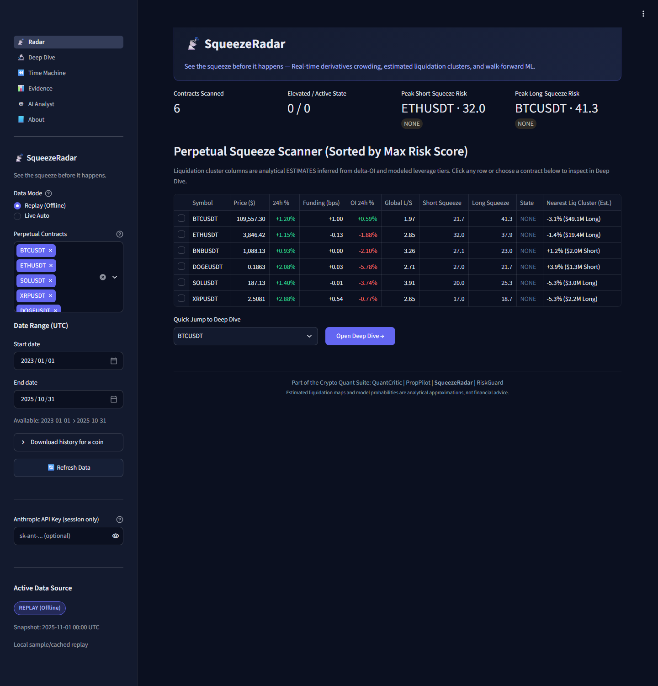
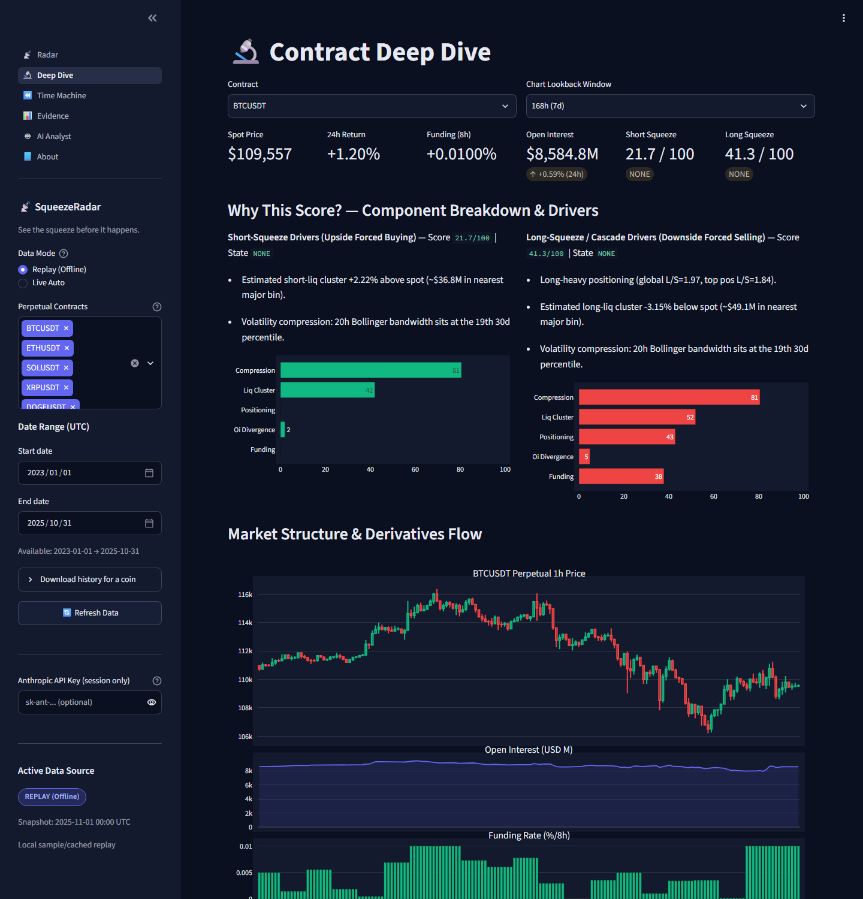
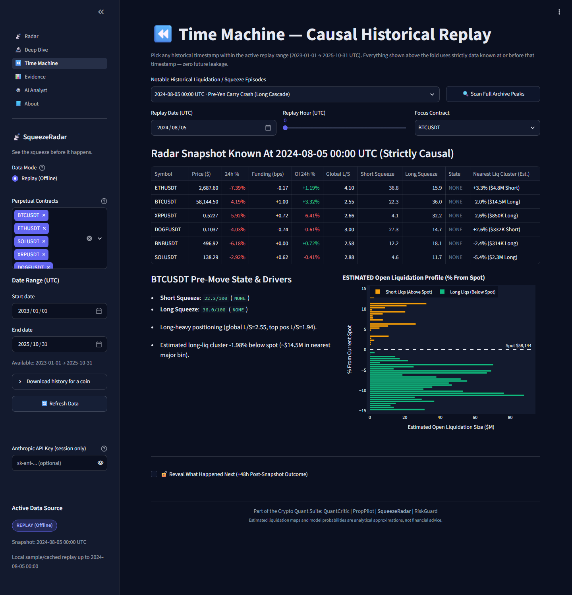
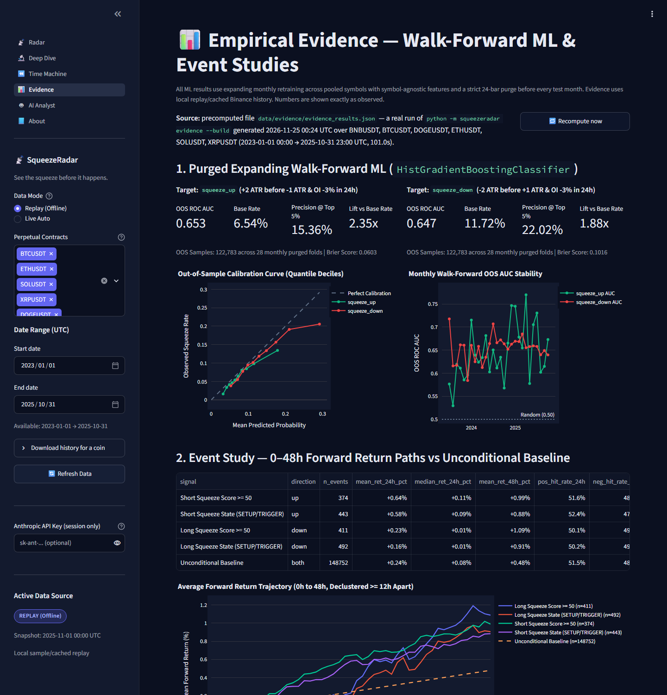
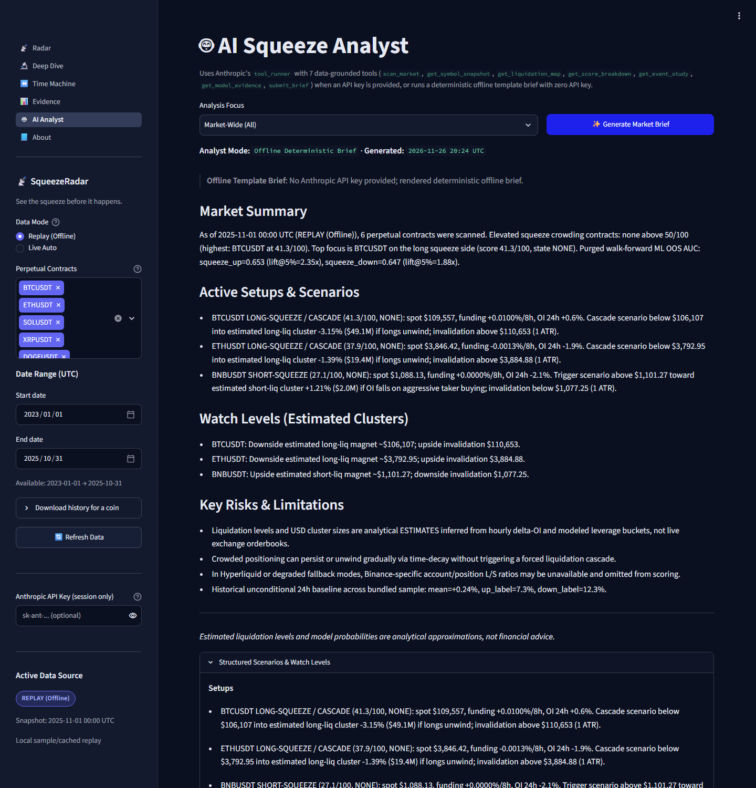
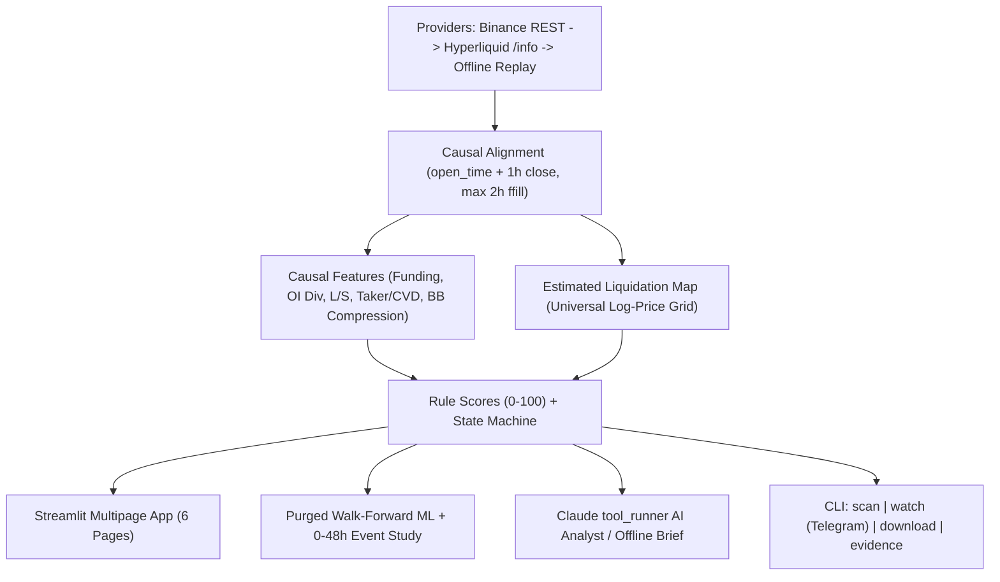

# 📡 SqueezeRadar

> **"See the squeeze before it happens."**  
> Real-time perpetual futures squeeze scanner, estimated liquidation cluster map, walk-forward ML validation, historical Time Machine replay, and Claude AI derivatives analyst.


---

## Screenshots

Real screenshots of the running app (headless Chromium, default settings, no API key).


<sub>Radar: squeeze score per contract with funding / OI / positioning drivers</sub>

| | |
|---|---|
| <br><sub>Deep Dive: price, OI, funding and estimated liquidation clusters</sub> | <br><sub>Time Machine: replay a past moment, then reveal what happened next</sub> |
| <br><sub>Evidence: walk-forward ROC-AUC, lift and calibration</sub> | <br><sub>AI Analyst market brief (offline mode shown)</sub> |

---

## Why Perpetual Squeezes Happen

Crypto perpetual futures track spot via periodic **funding payments** rather than an expiry date. When leveraged positioning crowds heavily to one side, four mechanical pressures align:

1. **Funding Carry Pain**: When shorts dominate, funding turns negative and shorts continuously pay longs (vice versa when longs crowd at high positive funding).
2. **OI-Price Divergence**: Rising Open Interest while price moves flat or opposite to the crowd signals trapped leverage accumulating rather than clearing.
3. **Concentrated Leverage & Liquidation Thresholds**: Retail and high-leverage traders cluster around discrete liquidation bounds (`long = p*(1 - 1/L + mmr)`, `short = p*(1 + 1/L - mmr)`).
4. **Forced Liquidation Cascades**: Once price touches a dense liquidation pocket, exchange risk engines fire market orders *in the direction of the move*, accelerating price into the next leverage tier while OI drops sharply.

---

## Key Features

- **Multi-Source Provider Chain with Automatic Fallback**: Binance USDT-M public REST (no keys) → Hyperliquid `/info` fallback (automatically catches geo-blocks like HTTP 451 on US cloud hosts) → Offline Replay on bundled real 2023–2025 Binance history plus cached downloads (`data/cache/`), with TTL caching and a live data-source badge.
- **Any Binance USDT-M Coin & Custom Date Range**: In Live mode, add any coin by ticker or shorthand (`pepe` → `PEPEUSDT` / `1000PEPEUSDT` validated against `/fapi/v1/exchangeInfo` or `/fapi/v1/ticker/24hr`) or scan the Top N contracts by 24h volume; in Replay mode, download and cache additional coins (`data.binance.vision` monthly klines/funding + threaded daily 5m metrics aggregated causally to 1h) and filter Deep Dive, Time Machine, and Evidence by start/end date.
- **100% Causal Feature Engine**: Funding rates & 30d z-scores, OI deltas & OI-price divergences, OI/24h volume crowding, global & top-trader long/short ratios, taker buy/sell flow, CVD proxy, ATR(14), and Bollinger bandwidth compression percentiles.
- **Estimated Liquidation Map (Clearly Labelled Estimate)**: Models open long/short liquidation density from hourly delta-OI, taker/direction flow splits, and configurable leverage tiers (`5x`–`100x`) on a universal log-price grid.
- **0–100 Rule Risk Scores & State Machine**: Separate Short-Squeeze and Long-Squeeze/Cascade scores with per-component explainability and a causal state machine (`NONE → SETUP → TRIGGER → IN_PROGRESS → EXHAUSTION`).
- **Purged Walk-Forward ML & Event Studies**: Pooled cross-symbol `HistGradientBoostingClassifier` retrained monthly on an expanding window with a strict **24-bar label-horizon purge** before each test month, plus `0–48h` forward return event studies.
- **Time Machine Replay**: Jump to any timestamp in the 2023–2025 archive (or curated/scanned liquidation episodes), inspect strictly causal pre-move signals, and toggle the `+48h` outcome reveal.
- **Claude AI Analyst & CLI Watch Alerts**: Official `anthropic` SDK `tool_runner` with 7 live-data tools (`scan_market`, `get_symbol_snapshot`, `get_liquidation_map`, `get_score_breakdown`, `get_event_study`, `get_model_evidence`, `submit_brief`), automatic offline deterministic brief fallback without an API key, plus `watch` CLI with optional Telegram alerts.

---

## Architecture



For deeper technical details, see [docs/METHODOLOGY.md](docs/METHODOLOGY.md) and [docs/ARCHITECTURE.md](docs/ARCHITECTURE.md).

---

## Quickstart

```bash
# 1. Install dependencies
pip install -r requirements.txt

# 2. Launch the web application (Replay mode works immediately offline)
streamlit run streamlit_app.py
```

### CLI Commands

```bash
# Scan bundled or downloaded historical data at a specific UTC timestamp
python -m squeezeradar scan --mode replay --at "2024-08-05 00:00"
python -m squeezeradar scan --mode replay --symbols LINKUSDT

# Scan live markets (accepts any Binance USDT-M symbol; falls back to Hyperliquid or Replay if blocked)
python -m squeezeradar scan --mode live --symbols BTCUSDT ETHUSDT pepe

# Watch for state transitions (optionally alerts Telegram if TELEGRAM_BOT_TOKEN & TELEGRAM_CHAT_ID are set)
python -m squeezeradar watch --symbols BTCUSDT ETHUSDT SOLUSDT --interval 300

# Download additional history from data.binance.vision (accepts YYYY-MM or YYYY-MM-DD)
python -m squeezeradar download --symbols LINKUSDT --start 2025-08 --end 2025-09
python -m squeezeradar download --symbols BTCUSDT ETHUSDT --start 2025-11-01 --end 2025-11-15 --out-dir data/downloaded

# Print the precomputed walk-forward / event-study evidence, recompute for custom coins/range, or rebuild (~1-2 min)
python -m squeezeradar evidence
python -m squeezeradar evidence --symbols BTCUSDT ETHUSDT --start 2024-01 --end 2025-06
python -m squeezeradar evidence --build
```

---

## AI Analyst Setup

SqueezeRadar runs cleanly **without an API key** using a deterministic offline brief built from the exact same metrics. To enable live Claude synthesis:

1. Copy `.env.example` to `.env` (or paste your key into the **sidebar input** — held in session memory only, never saved to disk).
2. Set `ANTHROPIC_API_KEY` (and optionally `SR_MODEL`, defaults to `claude-opus-5-5`).
3. Open **Page 5 · AI Analyst** and click **Generate Market Brief** to view the brief and tool-call audit log.

---

## Deploy to Streamlit Community Cloud

1. Fork or push this repository to GitHub (the bundled `data/sample/` archive is included for offline Replay and fallback).
2. Create a new app on [share.streamlit.io](https://share.streamlit.io) pointing to `streamlit_app.py`.
3. *(Optional)* Add `ANTHROPIC_API_KEY` under **App Settings → Secrets** (`ANTHROPIC_API_KEY = "sk-ant-..."`).
4. Note: Streamlit Community Cloud runs on US IPs where Binance Futures REST returns **HTTP 451**. SqueezeRadar's `ProviderChain` automatically detects 451 and falls back to **Hyperliquid** or **Offline Replay**, displaying the active source badge in the sidebar.

---

## Empirical Evidence

Numbers below are copied from `data/evidence/evidence_results.json`, written by `python -m squeezeradar evidence --build` (6 bundled symbols, 2023-01-01 → 2025-10-31, pooled purged expanding monthly walk-forward, 28 out-of-sample test months 2023-07 → 2025-10, 122,783 OOS bar-rows). The Evidence page loads the same file instantly and can recompute it live.

| Target (24h horizon) | OOS ROC AUC | Base rate | Precision @ top 5% | Lift @ top 5% | Brier | Monthly AUC range |
|---|---:|---:|---:|---:|---:|---:|
| `squeeze_up` (+2 ATR before −1 ATR, contract OI −3%) | 0.653 | 6.54% | 15.36% | 2.35x | 0.0603 | 0.529 – 0.770 |
| `squeeze_down` (−2 ATR before +1 ATR, contract OI −3%) | 0.647 | 11.72% | 22.02% | 1.88x | 0.1016 | 0.584 – 0.718 |

Event study (rule signals declustered ≥ 12h apart, whole bundled history):

| Signal | Events | Mean 24h return | `squeeze_up` label rate | `squeeze_down` label rate |
|---|---:|---:|---:|---:|
| Short Squeeze Score ≥ 50 | 374 | +0.64% | 13.9% | 15.8% |
| Short Squeeze State (SETUP/TRIGGER) | 443 | +0.58% | 11.7% | 15.1% |
| Long Squeeze Score ≥ 50 | 411 | +0.23% | 7.8% | 17.2% |
| Long Squeeze State (SETUP/TRIGGER) | 492 | +0.16% | 7.2% | 15.7% |
| Unconditional baseline (all bars) | 148,752 | +0.24% | 7.3% | 12.3% |

Reading: the model ranks squeeze bars better than chance in all 28 test months (lowest monthly AUC 0.529 for `squeeze_up`, 0.584 for `squeeze_down`), but the probabilities are small and the top decile is over-confident (calibration curve on the Evidence page). The short-squeeze rule signals roughly double the upside-squeeze rate; the long-squeeze rules raise the downside-squeeze rate (17.2% vs 12.3%) without a negative average return. No trading costs are modelled and no P&L is claimed.

---

## Limitations

- **Liquidation Map Is a Model Estimate**: Individual account leverage, cross-margin collateral, portfolio margin, and off-exchange hedges are private; liquidation clusters are estimated from aggregate hourly contract `delta-OI`, taker/price flow, and assumed leverage weights. It starts from the first bar of the loaded window (all OI seeded at that bar's price); the seed is swept/decayed away over time and needs 24 hourly OI observations before cluster metrics are reported.
- **Binance Public OI History Window**: Binance's `/futures/data/openInterestHist`, L/S ratio, and taker endpoints only retain the trailing **30 days** via live REST. Longer archives require `data.binance.vision` or the bundled `data/sample/`.
- **Hyperliquid Fallback Coverage**: Hyperliquid's `/info` API provides candles, hourly funding (converted x8 to the 8h-equivalent rate used everywhere else) and only the *current* OI snapshot. Without hourly OI history there is no estimated liquidation map, OI-change features or Binance-style L/S ratios in that mode; the rule scores re-weight across the components that are available.
- **No Profitability Guarantee**: Evaluation focuses on out-of-sample probability ranking, calibration, and forward return distributions without transaction costs, slippage, or execution guarantees. **Not financial advice.**

---

## Roadmap

- Add multi-exchange OI aggregation (Bybit, OKX) alongside Binance and Hyperliquid.
- Support custom leverage distribution profiles and user-tunable state thresholds in the UI.
- Add WebSocket streaming ticker mode for sub-minute trigger detection.


## Author

Built by **Surani Asim** as part of the Crypto Quant Suite: QuantCritic, PropPilot, SqueezeRadar and RiskGuard.
