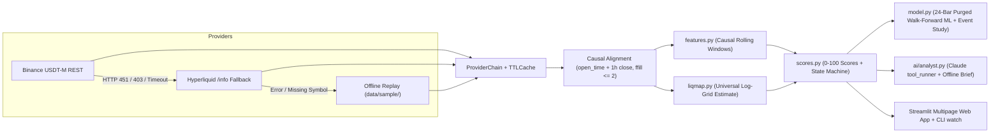

# SqueezeRadar Architecture

## Module Responsibilities

```text
squeeze-radar/
├── streamlit_app.py                 # Entrypoint configuring st.navigation across 6 pages
├── pages/
│   ├── 1_Radar.py                   # Live/Replay multi-symbol scanner table & deep-dive jump
│   ├── 2_Deep_Dive.py               # 4-row Plotly telemetry, liq heatmap/profile, score history & Why
│   ├── 3_Time_Machine.py            # Strictly causal historical replay + 48h outcome reveal
│   ├── 4_Evidence.py                # Walk-forward ML metrics, calibration, monthly stability, event study
│   ├── 5_AI_Analyst.py              # Claude tool_runner brief + tool log + offline template brief
│   └── 6_About.py                   # Methodology, data pipeline, and explicit limitations
├── squeezeradar/
│   ├── config.py                    # Pydantic configs (LiqMapConfig, ScoreConfig, StateConfig, MLConfig, ProviderConfig)
│   ├── data.py                      # Canonical CSV.GZ loader, causal alignment, and TTLCache
│   ├── providers/
│   │   ├── base.py                  # HttpJsonClient (timeouts, 429 backoff, 451 detection) & ProviderBadge
│   │   ├── binance.py               # Binance USDT-M public REST client (klines, funding, OI, L/S, taker)
│   │   ├── hyperliquid.py           # Hyperliquid /info fallback client (metaAndAssetCtxs, candles, funding)
│   │   ├── replay.py                # Offline bundled sample replay provider with as_of support
│   │   ├── chain.py                 # ProviderChain (Binance -> Hyperliquid -> Replay) + TTL cache
│   │   └── downloader.py            # CLI downloader for data.binance.vision archives
│   ├── features.py                  # Causal rolling derivatives, flow, volatility & divergence features
│   ├── liqmap.py                    # Universal log-price grid estimated liquidation map engine
│   ├── scores.py                    # 0-100 rule scores, component attribution, and causal state machine
│   ├── model.py                     # Triple-barrier/OI labels, purged monthly walk-forward ML & event study
│   ├── evidence.py                  # Build / save / load the precomputed evidence JSON
│   ├── pipeline.py                  # High-level Radar scan orchestrator & historical peak event finder
│   ├── ai/
│   │   ├── prompts.py               # System instructions & kickoff prompt builder
│   │   ├── tools.py                 # 7 @beta_tool closures over AnalystContext (<3000 char compact JSON)
│   │   └── analyst.py               # anthropic 2.x tool_runner integration + offline deterministic fallback
│   ├── cli.py                       # CLI (`scan`, `watch` with Telegram alerts, `download`, `evidence`)
│   └── ui.py                        # Shared Streamlit styling, st.cache_data wrappers & Plotly figures
├── data/sample/                     # Bundled 2023-2025 Binance USDT-M sample (6 symbols x 3 feeds)
├── data/evidence/                   # Precomputed evidence_results.json (from `evidence --build`)
└── tests/                           # Offline, mocked-HTTP unit + causality + E2E AppTest suite
```

## Data Flow & Fallback Chain



## Caching & Performance Design

- **Library Layer**: `TTLCache` caches live/replay `ProviderChain.load_symbols` calls in-memory.
- **UI Layer**: `@st.cache_data` caches scanner loads (Replay scanner uses the trailing 90d / 2,160 bars), the precomputed evidence file (keyed on its modification time), live evidence recomputes, and archive peak scans.
- **Evidence**: the 1-2 minute walk-forward + event study is precomputed by `python -m squeezeradar evidence --build` into `data/evidence/evidence_results.json` (~17 KB), so the Evidence page renders instantly; a **Recompute now** button re-runs it live.
- **Vectorized Liquidation Grid**: `liqmap.py` quantizes prices to `floor(ln(p) / 0.002)` so liquidation sweeps use contiguous NumPy array slicing rather than scanning open order lists per bar.
